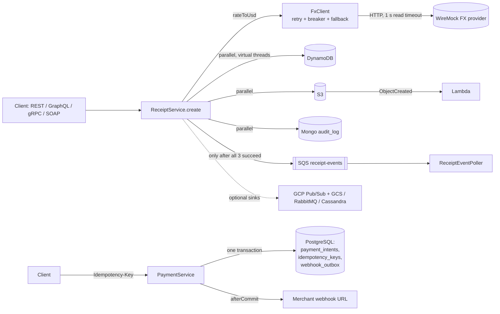

# misc-lab architecture

Written 11 Nov 2026 from the code on branch `miscellaneous` (commit `7075321b`). Every statement names the file it
comes from; paths are relative to `backend/src/main/java/com/deepak/misclab/` unless they start at the repo root.

## Components

| Component | Where | Role |
|---|---|---|
| Receipt API (REST, GraphQL, gRPC, SOAP) | `ReceiptController`, `ReceiptGraphqlController`, `ReceiptGrpcService`, `soap/ReceiptSoapEndpoint` | Four thin adapters over the same `ReceiptService` |
| `ReceiptService` | `ReceiptService.java` | FX conversion, parallel writes to DynamoDB + S3 + Mongo, then the `ReceiptCreated` event |
| `FxClient` | `FxClient.java` | Third-party FX HTTP call: timeouts, Resilience4j retry + circuit breaker, fallback rate |
| AWS (LocalStack) | `AwsConfig`, `AwsResourceInitializer`, `infra/terraform/`, `lambda/` | S3 bucket, SQS queue, DynamoDB table, Lambda on S3 `ObjectCreated` |
| SQS consumer | `ReceiptEventPoller.java` | Long-poll, log, delete (delete = ack) |
| Optional sinks | `gcp/GcpReceiptSink`, `messaging/RabbitReceiptPublisher`, `cassandra/`, `AzureBlobReceiptArchive` | Off by default (`misclab.*.enabled=false` in `application.yml`) |
| Payments | `payments/` + `resources/db/migration/V1__payments.sql` | PaymentIntent state machine on PostgreSQL, Idempotency-Key, signed webhook outbox, replay-safe receiver |
| Statements | `statement/` + `V2__statements.sql`, `V3__statement_indexes.sql` | Read path tuned in PERF-REPORT.md: 2-query fetch instead of N+1, optional Caffeine cache |
| Side services | `python-svc/` (FastAPI insights), `go-verify/` (webhook signature CLI), `spark/` (local payer count) | Separate builds, each with its own tests |
| UIs | `frontend/` (React + Vite), `frontend-angular/`, `templates/dashboard.html` (Thymeleaf) | Clients of the same REST API |
| Observability | Micrometer in the backend, `observability/prometheus.yml`, `observability/alert-rules.yml` | Prometheus metrics, ECS JSON logs (`logging.structured.format.console: ecs`), SLO burn-rate alerts |

## Data flow

Receipt write, step by step (`ReceiptService.java:78-95`):
1. `convert()` gets the FX rate (USD skips the call, line 63) and builds the receipt with a new UUID.
2. Three `CompletableFuture.runAsync` writes start on the `receiptIoExecutor` (virtual-thread-per-task, `ExecutorConfig.java:15`).
3. `awaitAll` (lines 98-115) waits for **all** three, not fail-fast, and collects every failure.
4. Only then is `ReceiptCreated` sent to SQS (line 89), extra sinks are called and `receipts_issued` is incremented.

Payment change, step by step (`payments/PaymentService.java:62-69`):
1. `TransactionTemplate` opens one transaction per public call.
2. `IdempotencyStore.execute` claims `(scope, idem_key)` with `INSERT ... ON CONFLICT DO NOTHING` (`IdempotencyStore.java:36`).
3. `findByIdForUpdate` takes a row lock (`PaymentRepository.java:13`, `PESSIMISTIC_WRITE`), the domain object applies the
   transition, `saveAndFlush` writes it with `WHERE version = ?` (`PaymentEntity.java:22`, `@Version`).
4. `WebhookPublisher.publish` inserts the signed event into `webhook_outbox` in the same transaction and registers an
   `afterCommit` hook to POST it (`WebhookPublisher.java:50-59`).

## Failure modes and how the code handles them

| Failure | Handling | Where | Test |
|---|---|---|---|
| FX provider slow | 500 ms connect / 1 s read timeout | `FxClient.java:35-37`, `application.yml` `fx.*` | `FxClientTest` |
| FX provider down | 2 attempts, then breaker (window 4, 50 %) opens; fallback rate 0.0119 | `FxClient.java:43-53`, `application.yml` `resilience4j` | `FxClientTest.retriesThenFallsBackOnServerError`, `circuitOpensAndStopsCallingProvider`; RUN-RESULTS step 7 (live, wiremock stopped) |
| One of DynamoDB / S3 / Mongo fails | `ReceiptWriteException` names every failed store, HTTP 503 with `failedStores`, no event sent | `ReceiptService.java:111-114`, `ReceiptController.java:26-32` | `ReceiptServiceTest.failedWriteFailsTheRequestAndPublishesNoEvent`, `everyFailedStoreIsReported` |
| Partial write left behind (not atomic) | Accepted: orphans under an id the client never got; consumers only learn via the SQS event sent after all writes | `ReceiptService.java:68-77` (Javadoc) | Documented, not prevented |
| SQS poll error | Caught and logged; undeleted messages reappear after the visibility timeout | `ReceiptEventPoller.java:34-36` | - |
| Duplicate payment create / capture / refund | Key row is a primary key; a racing duplicate waits on the winner, then returns the stored response | `IdempotencyStore.java:36-48` | `PaymentServiceTest` (50 concurrent same-key creates -> 1 row) |
| Same key, different request | 422 `KeyReuseException` (fingerprint mismatch) | `IdempotencyStore.java:45`, `PaymentController.java:65` | `PaymentServiceTest` |
| Concurrent refunds over-refunding | Row lock serializes writers; CHECK `refund_le_capture` is the DB backstop | `PaymentService.java:63`, `V1__payments.sql:13-14` | `PaymentServiceTest.concurrentRefundsNeverExceedCapturedAmount` |
| Lost update | `@Version` -> `ObjectOptimisticLockingFailureException` -> 409 | `PaymentController.java:74-77` | - |
| Illegal state transition | 409 `IllegalTransitionException`, transaction rolls back (key freed) | `PaymentController.java:62` | `PaymentIntentTest`, `PaymentServiceTest.failedTransitionRollsBackKeyAndEvent` |
| Webhook POST fails | Logged, never thrown; event stays in `webhook_outbox`. No relay yet | `WebhookPublisher.java:64-72` | - |
| Webhook replay / forged / stale | HMAC check, timestamp tolerance, event id stored in `webhook_received_events` (PK) | `WebhookVerifier.java:29-47`, `V1__payments.sql:43` | `WebhookSignatureTest` |
| RabbitMQ poison message | `AmqpRejectAndDontRequeueException` -> dead-letter exchange -> DLQ; duplicates ignored | `messaging/LedgerReceiptConsumer.java:31-38`, `RabbitReceiptConfig.java:30-39` | `RabbitReceiptIT` |
| Optional dependency not running | Redis/Rabbit health indicators off; Cassandra auto-config excluded unless enabled | `application.yml` `management.health`, `spring.autoconfigure.exclude` | - |

## Architecture decisions (ADRs)

**ADR-1: Parallel, non-transactional receipt writes; event only after all succeed.**
Decision: write DynamoDB, S3 and Mongo concurrently and publish to SQS last (`ReceiptService.java:78-95`).
Alternatives: sequential writes; a distributed transaction (2PC); write only DynamoDB and fan out from DynamoDB Streams.
Why: the three stores have no 2PC between them; publishing last means no consumer ever sees an event for an unstored
receipt. Measured gain was small (~35 ms per POST, RUN-RESULTS round 3), so the main value is the failure contract.
The Streams/outbox option is named in the README as the production fix for orphans.

**ADR-2: Idempotency in the database, not in memory.**
Decision: `idempotency_keys (scope, idem_key)` primary key + `INSERT ... ON CONFLICT DO NOTHING` inside the same
transaction as the change (`IdempotencyStore.java`, `V1__payments.sql:26`).
Alternatives: in-memory map (lost on restart, per instance); Redis `SETNX` (separate failure domain from the payment row).
Why: the key, the payment row and the outbox event commit or roll back together, so a failed capture frees the key.
Cost: PostgreSQL-specific SQL; the Oracle port did not move it (RUN-RESULTS round 4 limits).

**ADR-3: Pessimistic row lock plus optimistic `@Version`.**
Decision: `SELECT ... FOR UPDATE` for transitions, `@Version` as a second guard (`PaymentRepository.java:13`, `PaymentEntity.java:22`).
Alternatives: optimistic only (clients retry on 409); serializable isolation.
Why: refunds on one hot payment would mostly fail under optimistic-only; the lock makes them queue. CHECK constraints
stop an over-refund even if the code is wrong.

**ADR-4: Transactional outbox, deliver after commit, best effort.**
Decision: insert the signed event in `webhook_outbox` in the payment transaction; POST in `afterCommit`
(`WebhookPublisher.java:50-59`).
Alternatives: POST inside the transaction (merchant hears about a change that later rolls back); a message broker.
Why: an event exists if and only if the change committed. Gap: there is no relay, so a failed POST is not retried.
The retry policy (`payments/retry/`, exponential backoff + full jitter, DEAD_LETTER after max attempts) is built and
tested but not wired in (`WebhookRetrier` has no caller in `src/main`).

**ADR-5: FX resilience order Retry -> CircuitBreaker -> HTTP with timeouts, fallback on Retry.**
Decision: `@Retry(fallbackMethod)` outside `@CircuitBreaker` (`FxClient.java:43-44`); `CallNotPermittedException` ignored
by retry (`application.yml`).
Alternatives: fallback on the breaker; no fallback (fail the receipt).
Why: retry still sees real failures, an open breaker goes straight to the fallback rate without retrying.
Trade-off: a receipt can be priced with a stale fallback rate; the WARN log is the only signal.

**ADR-6: Optional infrastructure behind feature flags.**
Decision: Redis, RabbitMQ, Cassandra, Azure, GCP are off by default (`application.yml` `misclab.*.enabled`, profile `gcp`).
Alternatives: always-on dependencies in compose.
Why: the base app and older tests start with only the compose stack; each IT turns its feature on against a real
Testcontainers dependency.

## Not covered by this architecture (honest)
- No authn on the receipt and payment APIs; only `/api/oidc/**` has a JWT resource server (`OidcResourceServerConfig`).
- PCF `manifest.yml` is a descriptor only; never deployed.
- Redis, RabbitMQ and Cassandra are exercised only by Testcontainers ITs, not by the compose stack.
